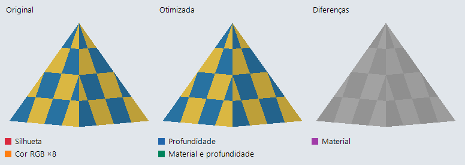

# MDL Optimizer

MDL Optimizer is an offline tool for GoldSrc Studio MDL v10 models used by Half-Life and Counter-Strike 1.6. It removes redundant faces, tests mesh reductions, and compares the original and optimized models across poses and camera angles. You can process a batch in the Windows app or from the command line.



The sample pyramid has a duplicate face on its base. Removing it reduces the mesh from seven triangles to six, with identical pixels in every test view.

## Run on Windows

The app requires **64-bit Windows and .NET Framework 4.8** or a later 4.x release.

- **From the portable package**, extract the entire `MDL-Optimizer-Windows-x64.zip` archive and open `MdlOptimizer.exe`.
- **From source**, open PowerShell in the repository root and run the commands below. The build uses the C# compiler included with .NET Framework on Windows.

```powershell
.\build.ps1
.\dist\MdlOptimizer.exe
```

Drag the main MDL file into the window, choose an output folder, and click **Optimize**. To try the bundled sample, open `tests/fixtures/piramide.mdl`. For split models, keep the companion texture and animation files alongside the main MDL.

Each run writes to a new folder. The `_exato` subfolder contains the mesh that matched the original pixel for pixel in the control views. The `_opt` subfolder contains the candidate with the fewest triangles that passed the search checks. The JSON report and comparison images show where the output differs. [User guide and validation criteria](docs/README.md)

## Command-line example

After building, run these commands to inspect the sample, optimize it, and verify the result. The example reads the output folder from the CLI response so it also works on repeat runs.

```powershell
$cli = '.\dist\MdlOptimizer.Cli.exe'
$model = '.\tests\fixtures\piramide.mdl'
& $cli info $model
$batch = & $cli optimize $model --out '.\artifacts\example' | ConvertFrom-Json
$candidate = Join-Path $batch[0].output 'piramide_opt\piramide_opt.mdl'
& $cli verify $model $candidate --strict
```

## Run the tests

```powershell
.\tests\Run-Tests.ps1
```

Run the suite in a Windows desktop session so it can exercise the WinForms interface. The script builds the app and tests geometry, rendering, and support for split models. It processes the sample twice, compares file hashes, and reopens each export. Results are saved in a subfolder of `artifacts/`.

To test your own models, pass `-ModelsDirectory` with the path to a folder of standalone MDLs. Use `-ResultsDirectory` to select a new or empty results folder, or `-SkipBuild` to test an existing build. You can also run the independent camera audit on a specific candidate. [Holdout audit instructions](tests/Holdout.md)

## Repository layout

| Path | Contents |
| --- | --- |
| `src/` | Studio model reader and writer, mesh simplification, visual audit, CLI, GUI, and translations |
| `tests/` | PowerShell scripts and C# regression tests |
| `tests/fixtures/` | Animated test pyramid and its QC, SMD, and BMP source files |
| `docs/` | User guide and sample visual comparison |
| `dist/` | Executables and portable ZIP generated by `build.ps1` |
| `artifacts/` | Local output from examples and test runs |

## Prepare a release

GitHub Actions builds and tests the app on Windows for pull requests and pushes to `main`. To prepare a release, push an annotated tag named `vX.Y.Z` that matches the version reported by `MdlOptimizer.Cli.exe --help`. Use the tag message for the English release notes.

The tag triggers a fresh build and test run. Actions attaches the tested **`MDL-Optimizer-Windows-x64.zip`** and its SHA-256 checksum to a draft and verifies the uploaded files. The archive includes the GUI, CLI, shared library, configuration files, and user guide. Open the draft under **Releases**, review the notes and assets, and click **Publish release** when ready.

The Half-Life SDK defines the binary layouts for bones, textures, sequences, and meshes. [Studio model header](https://github.com/ValveSoftware/halflife/blob/master/engine/studio.h)
